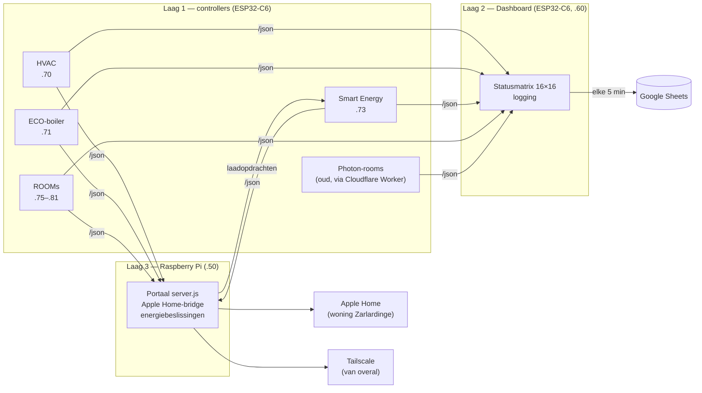

# Architectuur van het Zarlar-systeem

*Bijgewerkt 6 november 2026 — Filip Delannoy (FiDel)*

Dit document legt uit hoe het geheel in elkaar zit: welke toestellen er zijn, hoe ze met elkaar praten en welke afspraken overal gelden. Details per controller (pinnen, `/json`-keys, versies) staan in het [Master-document](../ESP32_Zarlar/Zarlar_Master_Overnamedocument.md) en in de README van elke repo.

---

## 1. Het idee

- **Elke ruimte of installatie heeft een eigen klein computertje** (een ESP32-C6). Dat meet, regelt en heeft een eigen webpagina. Valt er één uit, dan werkt de rest gewoon verder.
- **Elke controller publiceert zijn toestand op één adres: `/json`.** Alles wat meer wil weten, vraagt het daar op. De controllers sturen zelf niets naar buiten.
- **Twee centrale toestellen halen die gegevens op:** het **Dashboard** (een ESP32 met een lichtgevende statusmatrix, die ook naar Google Sheets logt) en de **Raspberry Pi** (het portaal met de uitgebreide webpagina's en de koppeling met Apple Home).

## 2. De drie lagen

| Laag | Wat | Doet |
|---|---|---|
| **1. Controllers** | ESP32-C6 op het Zarlar shield, één per installatie of kamer | Meten, lokaal regelen (ook zonder netwerk), `/json` publiceren, opdrachten uitvoeren via eigen adressen |
| **2. Dashboard** | ESP32-C6 met een matrix van 16×16 leds | Pollt alle controllers, toont hun toestand in kleur, **logt naar Google Sheets** |
| **3. Raspberry Pi** | Node.js-server op poort 3000 | Rijke webpagina's, **enige koppeling met Apple Home** (Matter-bridge), energiebeslissingen (tarieven, laden), bereikbaar van overal via Tailscale |

## 3. De toestellen

| Controller | Adres | Wat hij doet | Repo |
|---|---|---|---|
| Dashboard | 192.168.0.60 | Statusmatrix, logging naar Google Sheets | `Zarlardinge-Home-Automation` |
| Raspberry Pi | 192.168.0.50:3000 | Portaal, Apple Home, energie | `Zarlardinge-Home-Automation` (`zarlar-rpi/`) |
| HVAC | 192.168.0.70 | Verwarmingskringen, ventilatie, warmte-uitwisseling met de ECO-boiler | `ESP32C6_HVAC` |
| ECO-boiler | 192.168.0.71 | Pomp van de zonnecollector, warmte-inhoud van de boiler | `ESP32C6_ECO-boiler` |
| Smart Energy | 192.168.0.73 | Zonne-opbrengst, net, EPEX-prijzen, Tesla-laden | `ESP32C6_Smart-Energy` |
| ROOM | 192.168.0.75–81 | Per kamer: temperatuur, vocht, CO2, beweging, licht, verwarmingsvraag, verlichting | `ESP32C6_ROOMS` |
| ACCESS1–3 | 192.168.0.82–84 (gepland) | Buitenverlichting per zone; ACCESS2/3 voor de B&B (noord, oost). Horen samen | nog te maken |
| Tesla-proxy | 192.168.0.134 | BLE-verbinding met de Tesla, aangestuurd via Smart Energy | `ESP32C6_Smart-Energy` |
| S-OUTSIDE | 192.168.0.72 (gereserveerd) | Alleen een idee: buitenmetingen centraliseren | — |
| Photon-rooms | via de Particle Cloud | De oude kamercontrollers, tot ze vervangen zijn | `PHOTON_ROOMS` |

Alle controllers hebben een **vast IP-adres** in het thuisnetwerk.

## 4. Hoe de gegevens stromen

1. **Een controller meet** (bv. de ROOM leest elke paar seconden zijn temperatuursensoren) en **regelt lokaal** (bv. verwarmingsvraag aan of uit). Daar is geen netwerk voor nodig.
2. **Hij zet zijn toestand klaar op `/json`**: een kort JSON-bericht met korte sleutels (`a`, `b`, `c`…) om geheugen te sparen.
3. **Het Dashboard haalt alle `/json` op**, kleurt de matrix en stuurt **elke 5 minuten** een rij per controller naar een **Google Apps Script**, dat ze in een Google Sheet schrijft (één Sheet per type controller).
4. **De Raspberry Pi haalt dezelfde `/json` op** voor zijn webpagina's en voor **Apple Home**. Een knop in Apple Home wordt een opdracht van de RPi naar de controller (bv. `/set_home` op een ROOM).
5. **Van buitenhuis** werkt alles via **Tailscale** naar de RPi. De browser praat nooit rechtstreeks met een controller, altijd via `/api/` op de RPi.

**Waarom de controllers zelf niets naar Google sturen:** een HTTPS-verbinding vraagt veel geheugen. Op de ESP32 mislukte dat geregeld en gaf het herstarts. Sinds oktober 2026 is het een vaste regel: alleen het Dashboard logt.

**Waarom Matter niet meer op de ESP32's zit:** Matter kostte ±60 KB geheugen per controller, waardoor ze tegen de grens zaten. Sinds november 2026 doet alleen de RPi Matter (als bridge). Het grootste vrije geheugenblok steeg daardoor van ±30 KB naar ±240–250 KB.

## 5. Gemeenschappelijke hardware

- **Controller:** ESP32-C6-DevKitM-1 (32 pinnen, 16 MB flash), overal hetzelfde board.
- **Zarlar shield:** de draagprint met voeding (5 V via een zekering), connectoren en beveiliging. Belangrijkste connectoren:

| Connector | Waarvoor |
|---|---|
| RoomSense (RJ45) | Sensorbox in de kamer: DS18B20, DHT22, PIR, LDR |
| Option (RJ45) | Extra's: tweede PIR, thermostaatcontact, vrije pinnen |
| T-bus | DS18B20-temperatuursensoren (één draad voor meerdere sensoren) |
| Pixel-line | Adresseerbare leds en Powerpixels (zie hieronder) |
| I2C | Sensoren zoals de SCD41 (CO2) |
| SPI, relais, PWM | Specifiek voor HVAC en ECO |

- **Powerpixel:** eigen ontwerp. Wordt aangestuurd zoals een gewone adresseerbare led, maar schakelt via MOSFET's zware verlichting of RGB-strips.
- **Gouden regel:** een ESP32-pin krijgt nooit meer dan **3,3 V**.
- **Kamers:** wat er in elke room zit (en wat bewust niet), staat in de [ROOM-standaard](https://github.com/FidelDworp/ESP32C6_ROOMS/blob/main/ROOM_STANDAARD.md).

## 6. Gemeenschappelijke software

| Onderwerp | Afspraak |
|---|---|
| Ontwikkelomgeving | Arduino IDE, board "ESP32C6 Dev Module", Flash 16 MB |
| Partitietabel | `partitions.csv` naast elke sketch: twee app-delen van 6 MB, zodat OTA kan |
| Eerste keer flashen | Via USB |
| Daarna (OTA) | *Sketch → Export Compiled Binary*, enkel `<sketch>.ino.bin` uploaden op `http://<ip>/update` |
| Webpagina's | Elke controller heeft een eigen webserver. JavaScript staat in een `.h`-bestand (de IDE beschadigt JavaScript in een `.ino`) |
| `/json` | Korte sleutels, nieuwe sleutels altijd achteraan, nooit hernoemen zonder afspraak |
| Instellingen | Bewaard in NVS (het geheugen dat een herstart overleeft), aan te passen via `/settings` |
| Versies | Versiekop en changelog bovenaan elke sketch; één stap per versie; na elke flash 48 uur testen (geheugen en herstarts in de Sheet) |
| Google Sheets | Apps Script per type controller; bijwerken via "Implementaties beheren → nieuwe versie" (nooit een nieuwe implementatie, dan verandert de URL) |

## 7. Waar staat wat?

| Repo | Inhoud |
|---|---|
| [`Zarlardinge-Home-Automation`](https://github.com/FidelDworp/Zarlardinge-Home-Automation) | Dit overzicht, het Master-document, het Dashboard, het RPi-portaal |
| [`ESP32C6_ROOMS`](https://github.com/FidelDworp/ESP32C6_ROOMS) | ROOM-sketch en ROOM-standaard |
| [`ESP32C6_HVAC`](https://github.com/FidelDworp/ESP32C6_HVAC) | HVAC-controller |
| [`ESP32C6_ECO-boiler`](https://github.com/FidelDworp/ESP32C6_ECO-boiler) | ECO-boiler-controller |
| [`ESP32C6_Smart-Energy`](https://github.com/FidelDworp/ESP32C6_Smart-Energy) | Smart Energy-controller en Tesla-sturing |
| [`PHOTON_ROOMS`](https://github.com/FidelDworp/PHOTON_ROOMS) | Oude Photon-sketches (nog in gebruik) |
| [`HVAC_WONING`](https://github.com/FidelDworp/HVAC_WONING) | Ventilatie in de woning van Maarten |
| [`SJALAY-YSERMONDE`](https://github.com/FidelDworp/SJALAY-YSERMONDE) | Vakantiewoning Sjalay in Recht |
| [`ESP32C6_Experiments`](https://github.com/FidelDworp/ESP32C6_Experiments) | Testsketches |

Elke controller-repo heeft dezelfde indeling: `README.md`, een sketchmap met dezelfde naam als het `.ino`-bestand (met `partitions.csv`), `GoogleScript/`, `docs/` en `old/`.

## 8. Waar het naartoe gaat

- **Photons vervangen:** elke kamer krijgt een ESP32-C6 met dezelfde ROOM-sketch (eerst de B&B).
- **HVAC in productie** nemen, zodat de Photon S-HVAC kan verdwijnen.
- **ACCESS-controllers** voor de buitenverlichting (ook extra controllers bij de B&B).
- **mDNS** (`<naam>.local`) op alle controllers, en een statuspagina op de RPi.
- Uitwerking: Master-document §17 (optimalisatieplan) en de README van elke repo.
